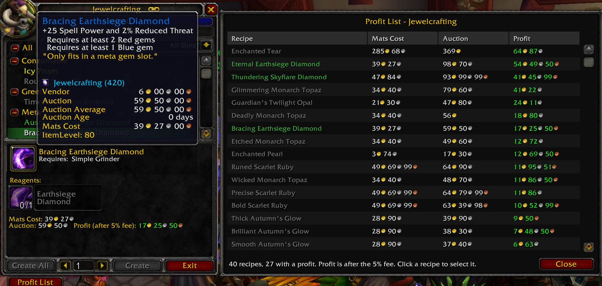
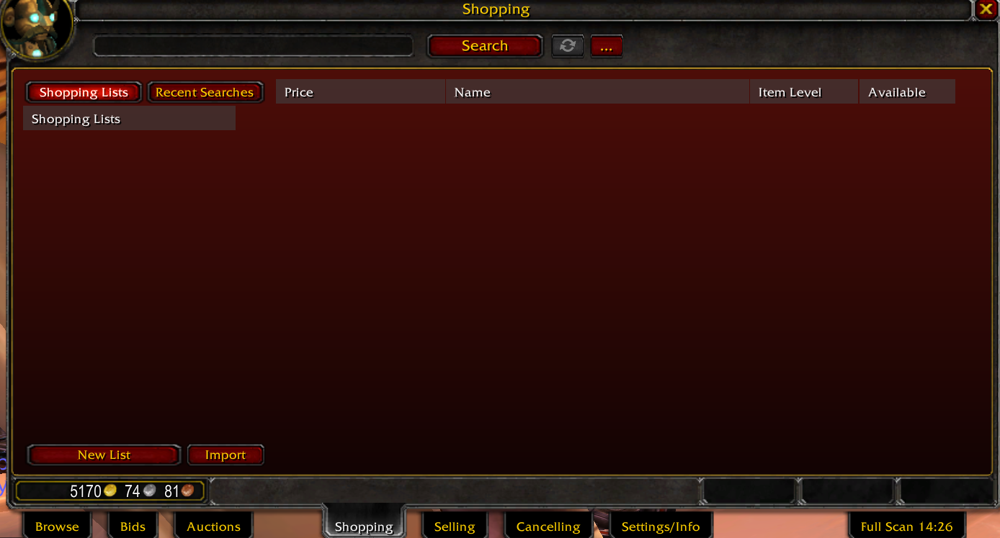

  
  

# Auctionary 1.51 - Start Guide

## What it does

### Shopping
Search, shopping lists, buy view. A single result opens directly; typos are corrected when nothing is found.

### Selling
Click an item in the bag grid, check the suggested price, post. Favourites get a star, good-to-sell items a green dot.

### Cancelling
Shows your auctions and marks which ones were undercut.

### Settings/Info
All switches, background colour, status.

### Full Scan
Button at the right end of the tab bar.

### Tooltips
Vendor, Auction, Average, Age, Mats Cost, Disenchant, Prospect, Mill.

## Good to know before you start

- **Scan first.** Prices, averages and the typo search all depend on scan data. The more scans over several days, the better the averages.
- The quick full scan has a 15-minute cooldown set by the client. The button shows the countdown. Shift-click scans page by page instead (slow).
- A full scan runs automatically when the auction house opens. This can be switched off.
- Buying, posting and cancelling need one click (or Enter) each. The client ignores these actions otherwise, so a quantity purchase is one click per stack.
- Enter posts in the Selling tab while an item is ready, so Enter does not open chat there. Switch it off in Settings/Info if that bothers you.
- Double-click to cancel is off by default and acts without confirmation when on.
- A green dot in the Selling tab means "good time to sell". It appears in the top-left corner of a bag item when the latest scanned price (today or yesterday) is at least 10% above that item's average. Hovering shows by how many percent.
- Values are estimates. Disenchant, Prospect and Mill use known drop chances and current asking prices, not what actually sells.
- Your own auctions are ignored when prices are saved.
- Items that cannot be disenchanted are only detected automatically on a character with Enchanting.
- Scan data is per account; two accounts do not share it.

## Shortcuts

- Shift-click an item anywhere while Shopping is open: search for it.
- Selling: right-click a bag item to make it a favourite. "History" without a selected item lists everything you posted.
- Cancelling: shift-click hides an item for the session.

## Installing and updating

- The Auctionary folder goes into `Interface\AddOns`.
- After an update that adds files, restart the game completely; otherwise `/reload` is enough.
- `/aury` lists the chat commands.
- It runs alongside TradeSkillMaster. Running it together with other auction house addons works but crowds the tab bar.
